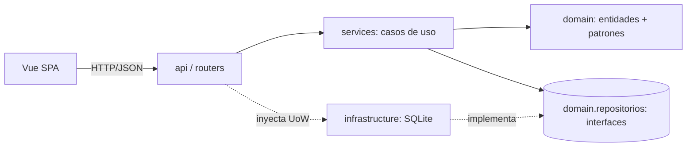
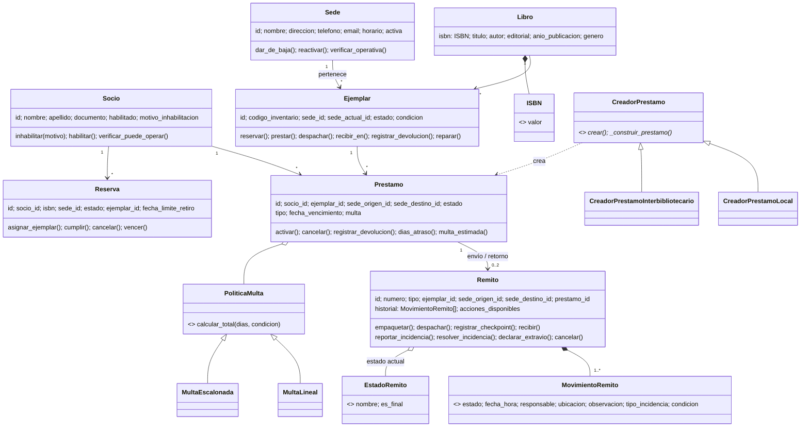
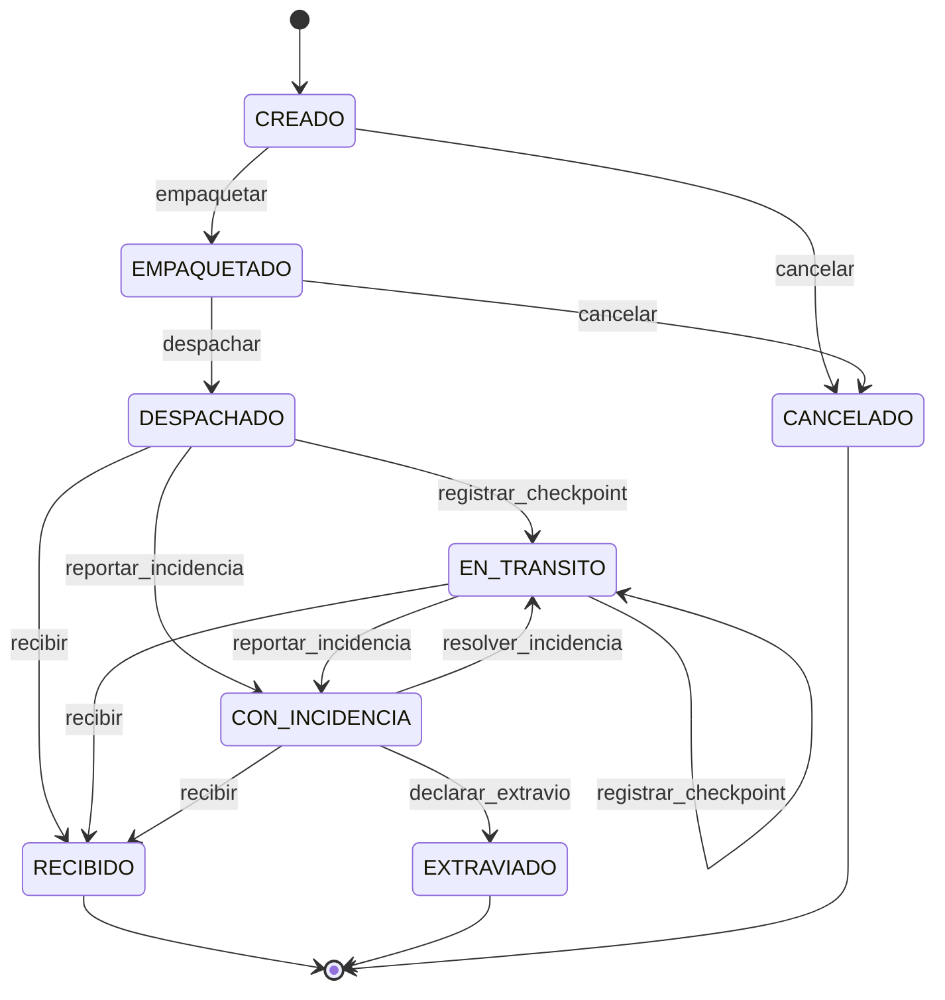

# DAO-TPI · Red de Bibliotecas: Sistema de Préstamos Interbibliotecarios

Trabajo Práctico Integrador 2026, Tema 1. Desarrollo de Aplicaciones con Objetos (UTN FRC).

- **Backend**: Python 3.12 + FastAPI, POO con dominio rico, SOLID y patrones de diseño, SQLite.
- **Frontend**: SPA en Vue.js 3 (Composition API) + Vue Router + Axios, construida con Vite.

---

## Cómo ejecutarlo

### Backend (http://localhost:8000, documentación Swagger en `/docs`)

```bash
cd backend
python -m venv .venv
.venv\Scripts\activate            # Linux/Mac: source .venv/bin/activate
pip install -r requirements.txt
python seed.py --reset            # base de demostración (simula ~4 meses de operación)
uvicorn main:app --reload
```

Tests (31 casos: dominio, servicios contra SQLite y API end-to-end):

```bash
cd backend
python -m pytest
```

### Frontend (http://localhost:5173)

```bash
cd frontend
npm install
npm run dev
```

En desarrollo, Vite redirige `/api` al backend (`vite.config.js`), por lo que no hace falta configurar CORS.
Para un backend en otra URL: `VITE_API_URL=http://servidor:8000/api npm run dev`.

---

## Estructura

```
DAO-TPI/
├── backend/
│   ├── domain/                  # Entidades, Value Objects, reglas y patrones (sin dependencias externas)
│   │   ├── sede.py, socio.py, libro.py (ISBN VO), ejemplar.py, prestamo.py, reserva.py, notificacion.py
│   │   ├── remito/              # Patrón STATE: remito.py (contexto) + estados.py (8 estados)
│   │   ├── fabricas.py          # Patrón FACTORY METHOD: creadores de préstamos
│   │   ├── multas.py            # Patrón STRATEGY: políticas de multa
│   │   ├── eventos.py           # Patrón OBSERVER: eventos de dominio + publicador
│   │   ├── repositorios.py      # Patrón REPOSITORY: interfaces + Unidad de Trabajo
│   │   ├── reloj.py             # Abstracción del tiempo (testeable)
│   │   └── excepciones.py
│   ├── infrastructure/          # Implementaciones concretas (SQLite)
│   │   ├── database.py          # Esquema
│   │   ├── repositorios_sqlite.py   # Repositorios + Unidad de Trabajo
│   │   └── consultas_sqlite.py      # Lecturas enriquecidas y reportes (CQRS liviano)
│   ├── services/                # Casos de uso (orquestación + validaciones entre agregados)
│   │   ├── sede_service.py, socio_service.py, catalogo_service.py
│   │   ├── prestamo_service.py, reserva_service.py, logistica_service.py
│   │   ├── reporte_service.py
│   │   └── notificaciones.py    # Suscriptores de eventos (Observer)
│   ├── api/                     # Capa REST (FastAPI)
│   │   ├── routers/             # sedes, socios, catalogo, prestamos, reservas, remitos, reportes
│   │   ├── esquemas.py          # Validación de entrada (Pydantic)
│   │   ├── serializadores.py    # Entidad -> JSON
│   │   ├── errores.py           # Excepción de dominio -> código HTTP
│   │   └── dependencias.py      # Inyección: UoW por request (commit/rollback)
│   ├── tests/
│   ├── seed.py                  # Datos de demostración generados con los propios servicios
│   └── main.py
└── frontend/
    └── src/
        ├── services/api.js      # Cliente Axios por recurso
        ├── views/               # Dashboard (reportes), Sedes, Socios, Catálogo, Préstamos, Reservas, Remitos
        ├── components/          # Modal, EstadoBadge, RemitoTimeline, StatTile, BarChart, StackedBar, Toasts
        ├── composables/         # useToast, formato
        └── router/
```

### Arquitectura en capas



Las dependencias apuntan siempre hacia el dominio. El dominio no importa FastAPI ni SQLite.

---

## Modelo de dominio



### Ciclo de vida del Remito (patrón State)



- Cada transición agrega un `MovimientoRemito` inmutable (fecha, responsable, ubicación, observación,
  incidencia, estado físico): esa es la **trazabilidad completa del trayecto**, que se persiste
  *append-only* en `movimientos_remito`.
- El remito no admite movimientos con fecha anterior al último registrado.
- **Tipos de remito**: `ENVIO` (origen a destino de un préstamo), `RETORNO` (vuelta a la sede
  propietaria tras la devolución o una cancelación) y `TRASLADO` (reasignación permanente de un ejemplar).
- **Efectos sobre otras entidades** (`LogisticaService`): al despachar, el ejemplar pasa a EN_TRANSITO. Al recibir un
  ENVIO, el préstamo pasa a LISTO_PARA_RETIRO; si el ejemplar llega dañado, el préstamo se cancela y se
  genera el retorno. Al recibir un RETORNO o TRASLADO, el ejemplar vuelve a estar disponible y se asigna
  a la siguiente reserva en cola. Un extravío da de baja el ejemplar y cancela el préstamo.
- La SPA no replica la máquina de estados: muestra los botones de `acciones_disponibles` que informa el backend.

### Préstamo

| Tipo | Flujo | Plazo | Multa (Strategy) |
|---|---|---|---|
| Local (origen = destino) | ACTIVO → DEVUELTO | 14 días desde la solicitud | Lineal: $500/día |
| Interbibliotecario | PENDIENTE_ENVIO → LISTO_PARA_RETIRO → ACTIVO → DEVUELTO | 21 días desde el retiro | Escalonada: $500/día los primeros 7, luego $1000/día |

Recargo por estado físico en la devolución: deteriorado +$2.000, dañado +$15.000 (el ejemplar queda fuera de circulación hasta su reparación).

---

## Patrones de diseño aplicados

| Patrón | Dónde | Por qué |
|---|---|---|
| **State** | `domain/remito/` | El remito tiene 8 estados con operaciones válidas distintas y transiciones no lineales. Cada estado concreto implementa sólo lo que permite; el resto lanza `TransicionInvalidaError`. Se evitan condicionales dispersos y agregar un estado no modifica los existentes. |
| **Repository + Unit of Work** | `domain/repositorios.py` (interfaces), `infrastructure/repositorios_sqlite.py` | Desacopla el dominio de la persistencia (DIP). Cada request HTTP usa una transacción: el caso de uso se confirma completo o se revierte. |
| **Factory Method** | `domain/fabricas.py` | `CreadorPrestamo.crear()` fija el algoritmo y las validaciones comunes; las subclases deciden qué préstamo construir, qué validar y cómo ocupar el ejemplar. |
| **Strategy** | `domain/multas.py` | La fórmula de multa varía por tipo de préstamo sin tocar `Prestamo` (Open/Closed). |
| **Observer** | `domain/eventos.py`, `services/notificaciones.py` | Los cambios de estado generan eventos y los suscriptores crean notificaciones al socio. Agregar email o SMS implica sumar un suscriptor. |

Otros principios aplicados:
- **SRP**: entidades con sus invariantes, servicios con la orquestación, repositorios con la persistencia, routers con HTTP.
- **DIP**: los servicios reciben la UoW, el reloj y el publicador por inyección.
- **Value Objects**: `ISBN` (valida el dígito verificador) y `MovimientoRemito`.

---

## Validaciones de negocio (y dónde se aplican)

| Validación | Implementación |
|---|---|
| No prestar ejemplares no disponibles | `CreadorPrestamo._validar_comunes` (sólo admite RESERVADO si viene de la reserva del socio) |
| No prestar a socios inhabilitados | `Socio.verificar_puede_operar` (al solicitar, al reservar y al entregar) |
| Controlar vencimientos | `Prestamo.dias_atraso/esta_vencido`. Un socio con préstamos vencidos no puede pedir otro (máximo 3 préstamos abiertos). Las reservas no retiradas en 3 días vencen. |
| Trazabilidad del remito | Historial inmutable y *append-only*, sin fechas hacia atrás |
| Evitar duplicados | Sede (nombre), socio (DNI), libro (ISBN normalizado), ejemplar (código de inventario), reserva activa por socio y libro, un solo remito en curso por ejemplar. También hay `UNIQUE` en la base. |
| Ejemplar de la sede de origen | Debe pertenecer a la sede origen y estar físicamente en ella |
| Sedes dadas de baja | `Sede.verificar_operativa` en préstamos, reservas, alta de ejemplares, creación y despacho de remitos. Además, una sede no puede darse de baja con remitos en curso, préstamos abiertos o reservas activas. |

---

## Reportes (no triviales)

1. **Préstamos activos y material en tránsito por sede**: activos locales e interbibliotecarios,
   pendientes de entrega, remitos por despachar, salientes y entrantes en viaje, y detalle con horas en tránsito.
2. **Préstamos vencidos y multas acumuladas**: multa estimada al día según la estrategia de cada tipo,
   agregada por sede, más el ranking de multas registradas en devoluciones.
3. **Libros más solicitados para préstamos inter-sedes**: ranking por período, con la cantidad de sedes que lo pidieron y que lo proveyeron.
4. **Disponibilidad de catálogo por sede**: ejemplares por estado, % disponible y ejemplares fuera de su sede.
5. **Logística**: tasa de envíos exitosos (recibidos sin incidencias sobre finalizados), tasa de incidencias,
   incidencias por tipo, tiempo promedio, mínimo y máximo de tránsito (despacho a recepción) por ruta, y envíos o recepciones por sede.

Endpoints: `GET /api/reportes/{prestamos-activos|vencidos|libros-mas-solicitados|disponibilidad-sedes|logistica}`.

## Procesos opcionales incluidos

- Envío de notificaciones (Observer), visibles por socio en la pantalla Socios.
- Revisión del estado de recepción de ejemplares (estado físico al recibir, incidencias de daño o extravío).
- Inventario con códigos (código de inventario único, autogenerado si no se indica).
